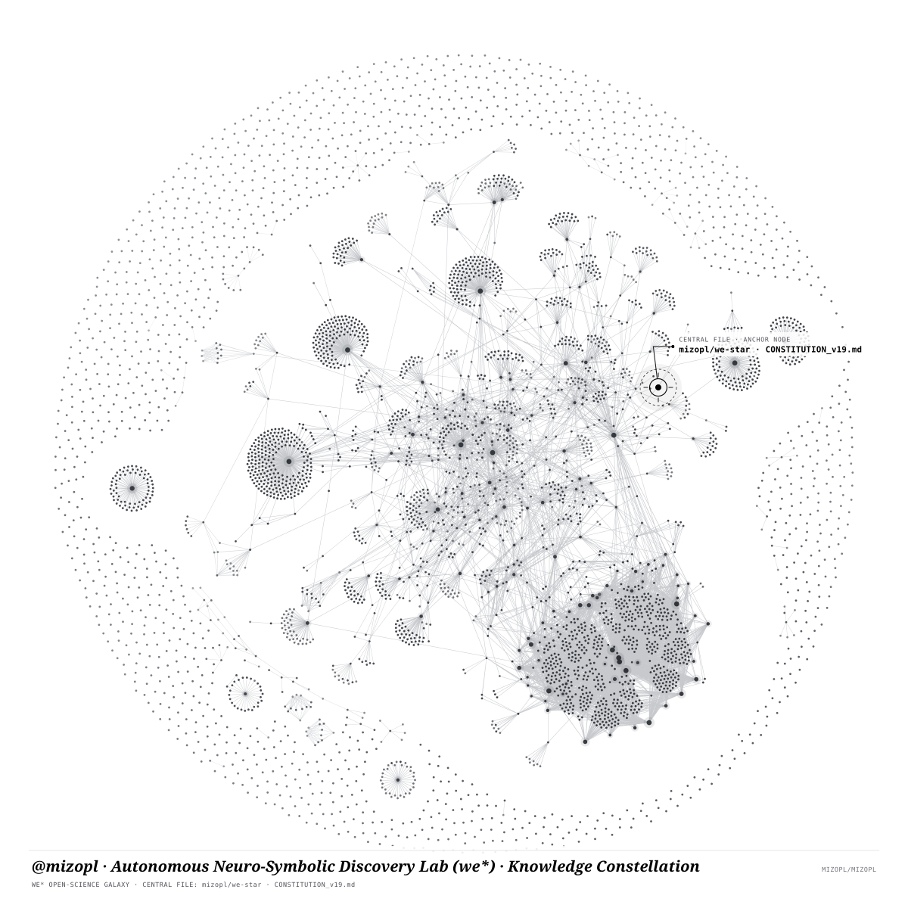

```text
+-[ @mizopl // autonomous scientific discovery & algorithmic optimization ]-+

Building autonomous neuro-symbolic discovery engines that find, prove,
and machine-verify new bounds, theorems, and constructions across mathematics,
physics, computer science, materials science, cryptography, astronomy, and
computational biology -- running on a single 16 GB MacBook Pro (M1).

. . : : [  prediction / postdiction / cognition / meta-learning /
           scalar / matrices / tensor decomposition / signal processing /
           combinatorial optimisation / creative decisions / symbolic proof /
           zero-error verification / discrete geometry / statistical mechanics /
           cryptanalysis / autonomous research / agentic / communication /
           intercommunication / graph theory / group dynamics / humanic /
           collective intelligence / self-correction  ] : : . .

+---------------------------------------------------------------------------+
| status :: open to investors, compute sponsors & R&D partnerships to scale |
| ethos  :: personally in favor of radical open source & shared discovery   |
|           (we* = human + AI + open-science community growing together)    |
| engine :: https://github.com/mizopl/we-star  (we* = me + AI + loop)       |
| record :: 44 verified packages / 36 benchmarks across 18/18 domains       |
+---------------------------------------------------------------------------+

--- autonomously engineered & zero-trust verified by Claude (v1-v12) & Gemini-CLSS (PROOFER) on @mizopl's behalf
--- we* = @mizopl + Claude (v1-v12) & Gemini-CLSS (PROOFER v13-v19) + the open-science feedback loop
```

<p align="center">
  <picture>
    <source media="(prefers-color-scheme: dark)" srcset="./assets/we_star_constellation_dark.svg">
    <source media="(prefers-color-scheme: light)" srcset="./assets/we_star_constellation_light.svg">
    
  </picture>
  <br>
  <sub><b><code>we*</code> Knowledge Galaxy:</b> 4,078 interconnected domain notes, Lean 4 / LRAT / Python verifiers, and standalone repositories anchored on <a href="https://github.com/mizopl/we-star"><code>mizopl/we-star</code></a> (<code>CONSTITUTION_v19.md</code> · <a href="./assets/we_star_constellation_dark.svg">dark</a> · <a href="./assets/we_star_constellation_light.svg">light</a>).</sub>
</p>

<p align="center">
  <picture>
    <source media="(prefers-color-scheme: dark)" srcset="./assets/we_star_tree_teaser_dark.svg">
    <source media="(prefers-color-scheme: light)" srcset="./assets/we_star_tree_teaser_light.svg">
    
  </picture>
  <br>
  <sub><b>Epistemic Bet-Tree Crown (Teaser Excerpt):</b> seven recent branches across quantum stabilizer ranks, Hadamard determinants, inverse RNA folding, and protein engineering — showing verified steps (<code>✓</code>), falsified twigs pruned by exact oracles (<code>✗</code>), and pivots (<code>↩</code>) (<a href="./assets/we_star_tree_teaser_dark.svg">dark</a> · <a href="./assets/we_star_tree_teaser_light.svg">light</a>). Public open-source releases currently go up to <code>CONSTITUTION v19</code> while newer trunk layers incubate in the lab.</sub>
</p>

### Flagship Repository: [**`mizopl/we-star` (`we* = me + agentic systems we* create + the feedback loop`)**](https://github.com/mizopl/we-star)

> [**Explore `mizopl/we-star` →**](https://github.com/mizopl/we-star) · [**Read `we*` Field Notes (`./news/`) →**](https://github.com/mizopl/we-star/tree/main/news)  
> Full constitutional architecture (`PROOFER`), `340+` ex-ante Brier-calibrated micro-bets, zero-trust verification gates, and **44 machine-verified proof packages across 36 benchmarks in all 18/18 scientific domains** (including **52 zero-axiom Lean 4 proof modules/theorems**). Selected upstream merges, catalog integrations, and independent third-party replays:
> - [**`elder-plinius/V3R1T4S` (`7` Merged `main` PRs + `44` Verified Packages)**](https://github.com/elder-plinius/V3R1T4S/pulls?q=is%3Apr+author%3Amizopl) — *Thank You, Pliny `@elder-plinius`!* Seven PRs merged into `main` across five domains ([`#366`](https://github.com/elder-plinius/V3R1T4S/pull/366) 45-digit `#P` torus partition count `OEIS A054759(15)` confirmed to all 45 digits in [`#459`](https://github.com/elder-plinius/V3R1T4S/pull/459), [`#433`](https://github.com/elder-plinius/V3R1T4S/pull/433) `(w=12, k=3)` DNA minimizer bound `0.136569`, [`#517`](https://github.com/elder-plinius/V3R1T4S/pull/517), [`#723`](https://github.com/elder-plinius/V3R1T4S/pull/723) & [`#724`](https://github.com/elder-plinius/V3R1T4S/pull/724) Lychrel Base-50, Base-98 & Base-146 proofs, [`#616`](https://github.com/elder-plinius/V3R1T4S/pull/616) ternary addition-reduced SLPs, and [`#617`](https://github.com/elder-plinius/V3R1T4S/pull/617) Herculaneum `PHerc. 343` registration), plus [`PR #1043`](https://github.com/elder-plinius/V3R1T4S/pull/1043) certifying $N_{\text{CCZ}}(4) = 10$ & $N_T(4) \ge 9$ on $\mathrm{RM}(3,7)$ in `34.90 s` and [`PR #1039`](https://github.com/elder-plinius/V3R1T4S/pull/1039) proving exact 5- to 8-copy stabilizer ranks in `8.50 s`.
> - [**`unitaryfoundation/stabrank` (`PR #193` & `PR #194` `MERGED`)**](https://unitaryfoundation.github.io/stabrank/people/we-mizopl.html) — `35/35` exact $\mathbb{Z}[i]$ / $\mathbb{Z}[\omega_3]$ Galois-certified stabilizer rank bounds (`20.46 s` single-core runtime, [`PR #193`](https://github.com/unitaryfoundation/stabrank/pull/193)) + `10/10` zero-axiom (`0 sorryAx`) Lean 4 proof modules ([`PR #194`](https://github.com/unitaryfoundation/stabrank/pull/194); standalone package in [`mizopl/we-star/stabrank`](https://github.com/mizopl/we-star/tree/main/stabrank)).
> - [**`teorth/optimizationproblems` (`PR #236` `MERGED` as `[M2026]`, `#339`)**](https://github.com/teorth/optimizationproblems/pull/236) — Explicit finite-depth ($N = 10^{13}, q = 27,995$) odd-base lower bound $C_{3a} > 1.19230254$ for the Erdős–GHR sum-difference constant (cited in [`constants/3a.md`](https://github.com/teorth/optimizationproblems/blob/main/constants/3a.md) as **`[M2026]`**) and sister constant $C_{3e} > 1.27255802$ ([`PR #339`](https://github.com/teorth/optimizationproblems/pull/339)), independently replayed from scratch in [`arhancanli/quantavane-replays`](https://github.com/arhancanli/quantavane-replays).
> - [**`solven-eu/matmulcatalog` (`PR #21` `MERGED`, `REFERENCES [92]`)**](https://github.com/solven-eu/matmulcatalog/pull/21) & [**`dronperminov/FastMatrixMultiplication`**](https://github.com/dronperminov/FastMatrixMultiplication) — Wired in as a 3-hourly automated upstream source (`UpstreamSchemeRepos.MIZOPL`), ingesting `52` `*-mizopl_2026-*.json` schemes across `11` ternary/integer rank reductions and `48` addition-reduced SLPs.
> - [**`codetables.de` Quantum Error-Correcting Code Tables**](https://www.codetables.de) — `5` optimal quantum stabilizer codes over $\mathbb{F}_5, \mathbb{F}_7, \mathbb{F}_8, \mathbb{F}_9$ published upstream, paired with a 1,008-cell purity audit ([`V3R1T4S PR #975`](https://github.com/elder-plinius/V3R1T4S/pull/975)).
> - [**`eternagame/eterna-hard`**](https://github.com/mizopl/we-star/tree/main/eterna-hard) & [**`Eterna100-V2`**](https://github.com/elder-plinius/V3R1T4S/pull/1031) — `95/100` on `Eterna100-V2` ([`V3R1T4S PR #1031`](https://github.com/elder-plinius/V3R1T4S/pull/1031) vs. `DesiRNA = 92/100`), plus `37/300` (`+ 1/1` Martian = `38` `check_design.py` `d_bp = 0` solves, `96/300` at `d_bp <= 1`, `128/300` at `d_bp <= 2`) across the 300-puzzle `eternagame/eterna-hard` benchmark.
> - [**`ihtc2024` Integrated Healthcare Timetabling (`commit c078cf57`)**](https://github.com/ihtc2024/ihtc2024.github.io/commit/c078cf57) & [**La Jolla Covering Repository (`LJCR`)**](https://dmgordon.org/cover/) — `31` official hospital scheduling Best-Known Solutions merged upstream and `3` covering design bounds ($C(94,13,5) \le 125,184$, $C(68,14,5) \le 15,675$, $C(40,16,7) \le 7,251$).

### Standalone Deep-Dive Verification Repositories (Inspired by `@elder-plinius` & `V3R1T4S`)

- [**`mizopl/hadamard-maxdet`**](https://github.com/mizopl/hadamard-maxdet) — **Hadamard Maximal Determinant Catalog ($1 \le n \le 120$):** Unified 120-order exact Bareiss catalog (`50 / 50` explicit open-order `{-1, +1}` witness matrices) plus `8` improved $n \equiv 1 \pmod 4$ lower-bound constructions ($n = 81, 89, 93, 97, 101, 105, 109, 117$, up to `+19.86%` on `n = 109`, [V3R1T4S PR #1053](https://github.com/elder-plinius/V3R1T4S/pull/1053)).
- [**`mizopl/conway-99-graph`**](https://github.com/mizopl/conway-99-graph) — **Conway's 99-Graph Problem (`srg(99, 14, 1, 2)`):** `42` zero-axiom (`0 sorryAx`) Lean 4 theorems (`5 Master Theorems`), `54` Dual-Encoded Pure-RUP LRAT (`0 RAT`) UNSAT certificates (collapsing prime order $p = 7$ `p7_fix1` from $>48\text{h}$ to $0.82\text{ s}$), and unconditional `(0,7,0)` $k_{\text{type1}} \ge 1$ LEGO & `56/56` sorted `1+1+4` 8-domain closure (`42,659,924,261` nodes, `sols = 0` in [`4ca6b95`](https://github.com/mizopl/conway-99-graph/commit/4ca6b95d3feea1c2a8c618c307497777f5c8ff3b), developed in two-way open-science collaboration with [`ibenarb/conway99-research`](https://github.com/ibenarb/conway99-research)).
- [**`mizopl/clss-quantum-ame-mds`**](https://github.com/mizopl/clss-quantum-ame-mds) — **Quantum AME & MDS Stabilizer Codes (`AME(n, D)`):** Closing `4` in-range (`D <= 10`) open cells (`AME(9,10)`, `AME(10,10)`, `AME(11,10)`, `AME(17,8)`) and `15` prime-power $D \ge 11, n \le 20$ cells (`95/95 = 100%` of prime-power $D \ge 11$ for $n \le 20$, [V3R1T4S PR #576](https://github.com/elder-plinius/V3R1T4S/pull/576) & [PR #614](https://github.com/elder-plinius/V3R1T4S/pull/614)).
- [**`mizopl/lychrel-bases-50-98-146-proof`**](https://github.com/mizopl/lychrel-bases-50-98-146-proof) — **Lychrel Numbers in Non-Power-of-Two Bases $b \in \{50, 98, 146\}$:** Mechanical carry-transducer template-closure proofs ([V3R1T4S PR #517](https://github.com/elder-plinius/V3R1T4S/pull/517), [PR #723](https://github.com/elder-plinius/V3R1T4S/pull/723), & [PR #724](https://github.com/elder-plinius/V3R1T4S/pull/724), all three merged into `V3R1T4S` `main`).
- [**`mizopl/ghr-c3a-odd-base-finite-bound`**](https://github.com/mizopl/ghr-c3a-odd-base-finite-bound) — **Gyarmati–Hennecart–Ruzsa Sum-Difference Constant ($C_{3a}$):** Explicit odd-base ($q = 27,995$) finite-depth lower bound $C_{3a} > 1.19230254$ (merged as `[M2026]` in [`teorth/optimizationproblems#236`](https://github.com/teorth/optimizationproblems/pull/236)) and sister constant $C_{3e} > 1.27255802$ ([`PR #339`](https://github.com/teorth/optimizationproblems/pull/339)).
- [**`mizopl/dreval-drug-response-transfer`**](https://github.com/mizopl/dreval-drug-response-transfer) — **DrEval Drug-Response Generalization & Ex-Vivo Transfer:** Air-gapped bilinear residual modeling and label-free assay-shift decomposition across `CTRPv2`, `GDSC2`, `BeatAML2`, and `PDX_Bruna` ([V3R1T4S PRs #835–#837, #984](https://github.com/elder-plinius/V3R1T4S/pull/984)).
- [**`mizopl/vesuvius-zdog-recto-parity`**](https://github.com/mizopl/vesuvius-zdog-recto-parity) — **Herculaneum Papyrus Scroll Surface & Parity Pipeline:** Thin-layer `Z-DoG` ink extraction, 3D inward *recto* normal-parity rectification, and cross-segment synchrotron CT sheet registration ([PR #617](https://github.com/elder-plinius/V3R1T4S/pull/617)).
