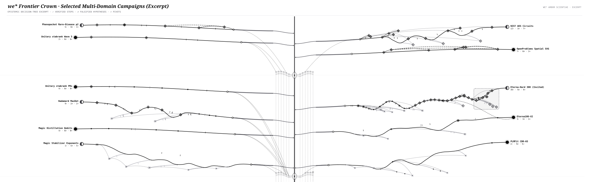

```text
+-[ @mizopl // independent builder · human half of we* ]--------------------+

Designing human-in-the-loop, neuro-symbolic discovery workflows that pair
AI proposers with cold, deterministic verifiers (Lean 4, SAT/LRAT, exact
integer/algebraic checks) — starting from a single 16 GB MacBook Pro (M1).

. . : : [  prediction / postdiction / meta-learning / symbolic proof /
           zero-error verification / discrete geometry / tensor algebra /
           combinatorial optimization / cryptanalysis / open science /
           collective intelligence / self-correction  ] : : . .

+---------------------------------------------------------------------------+
| we*    :: https://github.com/mizopl/we-star  (me + agents + feedback loop)|
| ethos  :: radical open source, falsifiable bets & machine-checked proofs  |
| status :: open to R&D partnerships, compute sponsors & curious minds      |
+---------------------------------------------------------------------------+
```

### Everything we* build lives in [**`mizopl/we-star`** →](https://github.com/mizopl/we-star)

`@mizopl` is just me (the human). The lab, constitutional ruleset ([`CONSTITUTION_v19.md`](https://github.com/mizopl/we-star/blob/main/CONSTITUTION_v19.md)), reasoning graphs, documented dead ends, and all **47 verification packages across 39 benchmarks** (including `9` merged [`V3R1T4S`](https://github.com/elder-plinius/V3R1T4S/pulls?q=is%3Apr+author%3Amizopl+is%3Amerged) PRs, `3/3` merged [`unitaryfoundation/stabrank`](https://unitaryfoundation.github.io/stabrank/people/we-mizopl.html) PRs, `[M2026]` in [`teorth/optimizationproblems`](https://github.com/teorth/optimizationproblems/pull/236), [`matmulcatalog`](https://github.com/solven-eu/matmulcatalog/pull/21), and `31` merged [`ihtc2024`](https://github.com/ihtc2024/ihtc2024.github.io/commit/c078cf57) BKS) are maintained together as **`we*`**:

- [**`mizopl/we-star`**](https://github.com/mizopl/we-star) — Full catalog, `StartFresh_v19/` starter kit, standalone verifiers, and [**Field Notes (`news/`)**](https://github.com/mizopl/we-star/tree/main/news).
- **Standalone proof repos:** [`hadamard-maxdet`](https://github.com/mizopl/hadamard-maxdet) · [`conway-99-graph`](https://github.com/mizopl/conway-99-graph) · [`clss-quantum-ame-mds`](https://github.com/mizopl/clss-quantum-ame-mds) · [`lychrel-bases-50-98-146-proof`](https://github.com/mizopl/lychrel-bases-50-98-146-proof) · [`ghr-c3a-odd-base-finite-bound`](https://github.com/mizopl/ghr-c3a-odd-base-finite-bound) · [`dreval-drug-response-transfer`](https://github.com/mizopl/dreval-drug-response-transfer) · [`vesuvius-zdog-recto-parity`](https://github.com/mizopl/vesuvius-zdog-recto-parity).

<p align="center">
  <picture>
    <source media="(prefers-color-scheme: dark)" srcset="./assets/we_star_constellation_dark.svg">
    <source media="(prefers-color-scheme: light)" srcset="./assets/we_star_constellation_light.svg">
    
  </picture>
  <br>
  <sub><b><code>we*</code> Knowledge Constellation:</b> 4,078 interconnected notes, Lean 4 / LRAT / Python verifiers, and proof packages anchored on <a href="https://github.com/mizopl/we-star"><code>mizopl/we-star</code></a> (<a href="./assets/we_star_constellation_dark.svg">dark</a> · <a href="./assets/we_star_constellation_light.svg">light</a>).</sub>
</p>

<p align="center">
  <picture>
    <source media="(prefers-color-scheme: dark)" srcset="./assets/we_star_tree_teaser_dark.svg">
    <source media="(prefers-color-scheme: light)" srcset="./assets/we_star_tree_teaser_light.svg">
    
  </picture>
  <br>
  <sub><b>Epistemic Bet-Tree Excerpt:</b> verified steps (<code>✓</code>), pruned dead ends (<code>✗</code>), and pivots (<code>↩</code>) from recent <code>we*</code> campaigns (<a href="./assets/we_star_tree_teaser_dark.svg">dark</a> · <a href="./assets/we_star_tree_teaser_light.svg">light</a>).</sub>
</p>
